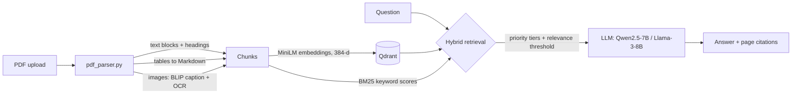

# Multimodal RAG Chatbot

Chat with your PDFs, including their **tables and images**. Answers cite the exact document and page. Retrieval is **hybrid** (semantic + keyword) and **source-priority aware**: you can mark a document as more trustworthy, and the chatbot prefers it.

**Stack:** FastAPI · Qdrant · Hugging Face Inference API (MiniLM embeddings, Qwen2.5 / Llama 3 for answers, BLIP for image captions) · PyMuPDF + pdfplumber · Apple Vision OCR · Next.js + React + Tailwind

Tested on a 189-page technical PDF with ~880 embedded images, indexed as 1,302 text, table and image chunks.

## How it works



**1. Ingestion** ([backend/pdf_parser.py](backend/pdf_parser.py))
- **Text:** grouped by paragraph block, tagged with the nearest page heading, and split into ~1,000-character chunks with 200 characters of overlap along sentence boundaries.
- **Tables:** extracted with pdfplumber and converted to Markdown. Long tables are split into 10-row pieces, with the header repeated in each.
- **Images:** extracted with PyMuPDF, captioned with BLIP (Hugging Face), and read with Apple Vision OCR ([backend/ocr.swift](backend/ocr.swift), macOS only), so text inside diagrams becomes searchable.

**2. Storage** ([backend/vector_store.py](backend/vector_store.py))
- Chunks are embedded with `sentence-transformers/all-MiniLM-L6-v2` and stored in a local, persistent Qdrant collection (cosine distance).
- Point ids are a hash of the content, so re-uploading a document doesn't create duplicates.

**3. Retrieval**
- **Hybrid score** = 60% semantic similarity (Qdrant) + 40% normalised BM25 keyword score. If the embedding API is unavailable, it falls back to BM25 only.
- **Source priority:** each document is High, Medium or Low. There are three modes:
  - `tiered` (default): answers from High-priority sources first. It falls back to lower tiers only when High has no strong match, and still lets in an exceptionally strong lower-tier match.
  - `standard`: ranks by score plus a priority boost.
  - `diverse`: takes chunks round-robin across documents.
- **Relevance threshold:** chunks below the threshold are dropped. If nothing is relevant, the model answers without document context instead of being fed weak context.

**4. Generation** ([backend/main.py](backend/main.py))
- Retrieved chunks are sent to the LLM with their source, page and type. The answer comes back with citations, including links to the images used.
- Choice of *detailed* or *concise* answers. Greetings and small talk skip retrieval entirely.

## API

| Method | Endpoint | Purpose |
| --- | --- | --- |
| POST | `/api/upload` | Upload and index a PDF |
| GET | `/api/documents` | List indexed documents and their priority |
| POST | `/api/documents/priority` | Set a document's priority: High, Medium or Low |
| POST | `/api/documents/clear` | Clear the index |
| POST | `/api/query` | Ask a question; returns an answer and citations |

## Run it

**Backend** (Python 3.10+):
```bash
cd backend
python3 -m venv venv && source venv/bin/activate
pip install -r requirements.txt
cp .env.example .env              # then paste your Hugging Face token
uvicorn main:app --reload --port 8000
```

**Frontend** (Node 20+):
```bash
cd frontend
npm install
npm run dev                       # http://localhost:3000
```
The frontend calls `http://localhost:8000` by default. Set `NEXT_PUBLIC_BACKEND_URL` to point it somewhere else.

## Test and debug

```bash
cd backend
python test_rag.py                         # builds 2 sample PDFs and checks source-priority retrieval
python evaluate_rag.py                     # index summary: chunk counts by type
python evaluate_rag.py "your question" --neighbors   # inspect retrieved chunks and scores
python rebuild_db.py                       # re-parse and re-embed everything in uploads/
```

`test_rag.py` creates an "official guidelines" PDF (High priority) and an unofficial "blog post" (Low priority) that contradict each other. It then checks two things: the official source wins, and a fact found only in the blog post is still retrieved.

## Project layout

```
backend/
  main.py           FastAPI app: upload, documents, priority, query
  pdf_parser.py     text / table / image extraction and chunking
  vector_store.py   Qdrant storage + hybrid, priority-aware retrieval
  ocr.swift         Apple Vision OCR helper (macOS)
  test_rag.py       end-to-end priority test with generated PDFs
  evaluate_rag.py   retrieval inspection tool
  rebuild_db.py     rebuild the index from uploads/
frontend/
  src/app/page.js   chat UI: upload, priorities, answers with citations
```

Uploaded documents, extracted images, the vector index and `.env` are git-ignored and never committed.
